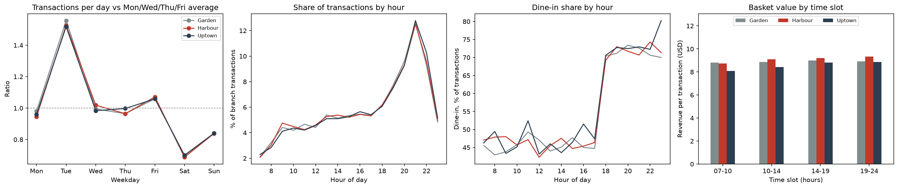

# Stories Coffee: Garden pays 43% more for every product and still charges less

**Team:** Rakan Bou Hatoum Hamadeh · Muche Abere Workie
EECE 490 (Introduction to Machine Learning), American University of Beirut · Hackathon, October 17, 2026

## Conclusion
Stories' biggest money is in how Garden's costs are set and in prices nobody has reviewed: Garden's recorded unit cost is 1.43 times Harbour's on every product, and no price changed in six months while Lebanon's consumer prices rose about 17% a year. Auditing Garden's cost setting (est. $15,888 per six months) and reviewing prices (est. $8,096 at elasticity −1) are the two largest actions. Next is finding what Stories does on Tuesdays, when transactions run about 1.5 times a normal weekday, and copying it to Saturday, its quietest day (est. $3,468–$6,937). Stopping the blanket 10% discount saves $1,706 with no measured downside, and Harbour's 15% promo should not be extended without a proper test.

| Rank | Action | Measured evidence | Estimate, 6 months (Jan–Jun) | Confidence | Confirming test |
|---|---|---|---|---|---|
| 1 | Audit how Garden's standard costs are set and bring them to Harbour's level | Garden's unit cost is 1.4302× Harbour's on all 45 products, unchanged for six months; Garden keeps 47% of sales as gross profit, Harbour 65% | +$15,888 if Garden paid Harbour's unit costs (estimated) | Medium: the gap is exact, but whether it is cash or bookkeeping is unknown | Compare Garden's and Harbour's supplier invoices for 5–10 products; check how overheads are loaded into unit cost |
| 2 | Review prices in line with inflation, starting with Garden and Uptown | 0 price changes on 135 price lists in six months; Lebanon CPI +17.25% a year; Garden's prices are 95% and Uptown's 91% of Harbour's | +$8,096 for a 6.86% rise at elasticity −1; range −$3,907 to +$20,922; loses money beyond elasticity −1.67 (estimated) | Low to medium: price sensitivity cannot be measured in this data | Raise a random half of products for four weeks; roll out if their units fall by less than 10.5% |
| 3 | Find what Stories does on Tuesdays and copy it to Saturday | Tuesday is 1.53× the other weekdays at every branch, every week. It is not a discount day (10.1% vs 9.4% of transactions discounted) and not new customers (64.2% vs 63.4% identified). Saturday is the quietest day, 0.63× | +$3,468 to +$6,937 if Saturday gains 25–50% of Tuesday's lift; +$7,993 if it reaches the weekday average (estimated) | Low: the Tuesday driver is unknown | Ask marketing and operations what happens on Tuesdays, then A/B test it on Saturdays by branch-week |
| 4 | Prompt food with drink orders, without a discount | 59% of drink orders carry no food; the attach rate runs from 38.1% (Cold Coffee) to 43.0% (Matcha & Tea) | +$644 to +$4,341 (estimated) | Low: the effect of a prompt is not measured | Till prompt at Harbour, with Garden and Uptown as controls; about 22 days detects a 5-point rise |
| 5 | Stop the blanket 10% discount | $1,706 given away on 5.5–5.8% of lines at every branch; no effect on basket size | Up to +$1,706 if no sales are lost (cost measured) | Medium: the cost is exact, but the effect on visits is unknown | Stop it at one branch for four weeks and compare visits with the other branches |
| 6 | Do not extend Harbour's 15% promo without a proper test | $470 of discounts; the rise in promoted categories grew after the promo ended, so we do not credit it to the discount | Net +$599 only if the promo caused the rise; range −$299 to +$1,451 (estimated) | High that causation is not shown | Rerun it on alternating weeks at one branch |
| 7 | Staff Tuesdays with the weekday forecast | June forecast error on Tuesdays: 9.0 transactions a day, against 15.2 for "same weekday last week" | No dollar figure; labour cost is not in the data | Medium | Compare with till-session counts |

How to read the table:
- **Ranking.** Rows are ranked by their central estimate.
- **Rows 1 and 2 overlap at Garden.** After a cost fix, each customer lost to a price rise costs more, so doing both is worth a little less than the sum. For Garden moving to Harbour's prices, the overlap is $757 at elasticity −1.
- **Row 2 and the branch price moves.** Row 2 already covers moving Garden and Uptown to Harbour's list, worth +$2,516 and +$1,782 at elasticity −1 in the estimates below. Do not add those to row 2.
- **Row 3** assumes extra Saturday visits are new, not moved from other days.
- **Row 4** is priced at today's food margins. The evening dessert test in finding 9 is part of it.

## The business problem
Stories already knows what each branch sells. We looked instead at decisions where the data points to money left on the table:
- what each branch pays for its products, and how each branch sets its prices;
- whether its two discounts, the 10% discount and Harbour's 15% promo, earn back what they give away;
- how many customers to plan for on each day of the week.

Gross profit is the measure throughout, because it is what is left to pay staff and rent. Revenue would hide Garden's problem.

## Measured findings
Facts computed directly from the data (after removing 132 duplicate rows). Each one points to the script and the table that produce it.

1. **Garden earns far less gross profit per dollar of sales than the other branches.** Gross margin, January to June 2026:

   | Branch | Revenue (USD) | Gross profit (USD) | Gross margin |
   |---|---|---|---|
   | Harbour | 150,099 | 97,503 | 65.0% |
   | Uptown | 55,554 | 34,795 | 62.6% |
   | Garden | 99,531 | 46,696 | 46.9% |

   The gap is the same every month (Garden 46.7–47.2%), so it is stable over time, not a one-off.

2. **The gap comes from unit cost, not price.** For every one of the 45 products, Garden's recorded unit cost is 1.43× Harbour's (range 1.426–1.439). Garden's prices are about 5% *lower* than Harbour's (Uptown's about 9% lower). A uniform 43% markup on every product is consistent with a branch-level cause, such as supplier terms, delivery costs or how costs are allocated to Garden, rather than recipes or waste on specific items. The data cannot tell whether Garden *pays* more or only *books* more.

   Follow-up tests in [`GARDEN_CAUSE.md`](GARDEN_CAUSE.md) find the gap is one flat factor of 1.4302 on every product, with a 95% interval of 1.4297 to 1.4309 and no fixed fee per unit. The factor does not move with Brent crude, even though Brent roughly doubled, and Garden's customers, hours and baskets look like the other branches'. The most likely explanation is a branch-level cost rule, such as an allocation or a standard-cost factor, rather than real invoices. The cost audit is what would confirm this.

3. **Each branch has one fixed price list, set as a flat percentage of Harbour's prices, whatever the branch's costs.** All 135 product-branch pairs have exactly one price and one unit cost over the six months. Every Uptown price is 91.2–91.6% of Harbour's and every Garden price is 95.1–95.3% of Harbour's. So Garden, the branch whose costs are 43% higher, charges *less* than Harbour. At list prices, before any discount, the share of revenue kept as gross profit is:

   | Branch | Price vs Harbour | Unit cost vs Harbour | Margin at list price |
   |---|---|---|---|
   | Harbour | 1.000 | 1.000 | 65.3% |
   | Uptown | 0.914 | 0.960 | 62.9% |
   | Garden | 0.952 | 1.430 | 47.2% |

   Source: `src/pricing_analysis.py`, `results/pricing_ratios_summary.csv`, `results/pricing_list_margin_by_branch.csv`.

4. **Tuesday has about 1.5 times the transactions of other weekdays, every week, at every branch, and it is not one of the recording errors we tested.** Mean transactions per calendar day:

   | | Mon | Tue | Wed | Thu | Fri | Sat | Sun |
   |---|---|---|---|---|---|---|---|
   | All branches | 178.0 | 284.5 | 186.2 | 180.0 | 197.5 | 128.7 | 155.7 |

   Tuesday divided by the Monday, Wednesday, Thursday and Friday average is 1.56 at Garden, 1.53 at Harbour and 1.52 at Uptown. It is the busiest day in all 25 full weeks, with a weekly ratio between 1.32 and 1.69. We tested five ways it could be a recording error:
   - *Another day's sales posted on Tuesday:* Monday and Wednesday are not lower than Thursday and Friday, and transaction IDs follow the date exactly with no Tuesday out of sequence.
   - *Copied records:* transactions repeating the same branch, second of the day and products appear at the same rate as on other days.
   - *A few event days:* no week falls below 1.32.
   - *One event slot, e.g. a Tuesday-evening offer:* the hour-by-hour profile matches other days, with the largest gap 0.62 points; a permutation test gives p = 0.75.
   - *Different buyers:* items per transaction and spend per transaction differ from other days by under 1%, and category shares, dine-in share and known-customer share by about one percentage point or less, and 99.2% of known Tuesday customers also buy on other days.

   Tuesday is the same customers buying the same things at the same hours, just about 1.5 times as often. It is not a discount day: 10.1% of Tuesday transactions carry a discount, against 9.4% on other days. It is not new customers either: 64.2% of Tuesday transactions have an identified customer, against 63.4%. Dine-in is 58.3% against 59.3% (`results/tuesday_discount_customer_mix.csv`). Saturday is the quietest day. Source: `src/tuesday_check.py`, `results/tuesday_*.csv`, `figures/tuesday_check.png`.

5. **A simple weekday-and-growth model forecasts daily transactions better than "same weekday last week", most of all on Tuesdays.** Target: transactions per branch per day. We chose between two models on May, after training on January to April. Then we refit the chosen model on January to May and tested it once on June. The model is a per-branch regression of log(transactions) on weekday plus a time trend. It uses no June data. The baseline uses the actual count from seven days earlier, so it has more recent information than the model. June mean absolute error, in transactions per day:

   | Model | Garden | Harbour | Uptown | All | Tuesdays | Other days |
   |---|---|---|---|---|---|---|
   | Dummy (training mean) | 18.15 | 31.30 | 11.35 | 20.27 | 55.04 | 13.31 |
   | Same weekday last week (baseline) | 10.23 | 11.23 | 7.33 | 9.60 | 15.20 | 8.48 |
   | Weekday + log trend | **6.96** | **8.17** | **5.74** | **6.95** | **9.02** | **6.54** |

   On May validation the order was the same, with all-branch errors of 6.12 for the model and 8.94 for the baseline. **Business use:** this sets Tuesday staffing and stock. In June, Harbour averaged 168.8 transactions on Tuesdays against 111.5 on other weekdays. Planning Tuesdays like a normal weekday would be off by 57.3 transactions a day at Harbour. The model's Tuesday error there was 12.2, and the baseline's was 18.6. The forecast assumes the Tuesday pattern is real, as discussed in finding 4. Source: `src/forecast.py`, `results/forecast_mae.csv`, `results/forecast_tuesday.csv`, `results/results.csv`, `figures/forecast_june.png`.

6. **Harbour's 15% promo on Cold Coffee and Desserts shows no clear evidence that it caused extra sales.** All 502 lines with a 15% discount are at Harbour, from 12 March to 19 May, on those two categories only. 23.2% of eligible lines in the window got the discount. We used a difference-in-differences on daily units, with Garden and Uptown as controls. Day fixed effects absorb season and chain-wide growth. The 95% intervals come from a bootstrap over whole weeks:

   | Test | Effect during promo | Effect after promo ended |
   |---|---|---|
   | Harbour vs Garden + Uptown | +13.7% [+2.0, +27.7] | +18.6% [+8.1, +29.2] |
   | Garden as only control | +6.9% [−4.3, +21.0] | +10.1% [−1.5, +22.8] |
   | Uptown as only control | +21.1% [+6.0, +41.1] | +27.8% [+10.5, +46.4] |
   | Placebo: categories not on promo | −1.5% [−5.7, +2.9] | +3.4% [−1.3, +8.2] |
   | Placebo: Cold Drinks, weather-sensitive, never discounted | −1.3% [−16.1, +15.8] | −5.1% [−24.3, +13.4] |
   | Placebo: fake promo window, Feb 1 to Mar 11 | −1.6% [−15.2, +13.0] | n/a |

   The placebo on categories not on promo is flat with a tight interval. The Cold Drinks and fake-window placebos are also near zero, but their intervals are too wide to rule out an effect of this size. The pre-promo trend test is inconclusive: −0.28 to +0.62 points per week over only 10 weeks cannot rule out a Harbour-specific trend. Moreover, the gain is *larger after the discount stopped*, Harbour only pulls away about five weeks into the promo, and the size depends on which branch is the control. A discount effect would end when the discount ends. So we do not credit the promo with the rise. Any effect would also come from an offer that reached under a quarter of eligible purchases, and nothing in the data says who got it or why. Source: `src/promo_analysis.py`, `results/promo_*.csv`, `figures/promo_weekly.png`.

7. **The 10% discount does not lead to bigger baskets.** It appears on 5.5–5.8% of lines at every branch, 5.4–5.9% in every month and 5.3–6.2% on every weekday. Known customers get it at the same rate as everyone else, 63.2% vs 63.6% of transactions. Discounted transactions look bigger, with 0.23 more items. But shuffling the discount at random across lines produces the same gap, 0.23, because the discount is applied per line and bigger baskets have more lines to land on. For the same product at the same branch, a discounted line has the same quantity as a full-price one, a difference of +0.0004 units. The basket comparison leaves out the 458 transactions that also contain a 15% promo line. This test covers basket size only. It cannot show whether the discount changes who visits or how often. Discounts given on all 10% lines, January to June: **$1,706**. Source: `src/discount_analysis.py`, `results/discount_*.csv`.

8. **59% of drink orders carry no food, and how often food is added depends only on the drink type.** Drinks are Hot Coffee, Cold Coffee, Cold Drinks and Matcha & Tea. Everything else is food. The "attach rate" is the share of transactions with a drink that also have food, and it is 40.8% overall. 13,865 drink transactions have no food, against 9,563 that do. The attach rate is the same across branches, hours, weekdays and months. It varies only with the most expensive drink in the basket:

   | Segment | Attach rate | Real difference? |
   |---|---|---|
   | Branch: Garden / Harbour / Uptown | 41.8% / 40.2% / 40.9% | No, p = 0.10 |
   | Hour, 17 hours | 39.4% to 43.1% | No, p = 0.89 |
   | Weekday / month | 39.8% to 41.9% / 40.2% to 41.5% | No, p = 0.39 / 0.82 |
   | Drink: Cold Coffee / Cold Drinks / Hot Coffee / Matcha & Tea | **38.1%** / 40.7% / 41.1% / **43.0%** | Yes, p < 0.0001, also after adjusting for branch, hour, day and month |

   The drink-type gap appears inside every branch. Some drink and food pairs sell less often together than item popularity predicts. To test this, we reshuffled items 2,000 times, keeping each basket's size and branch fixed. Cold Drinks + Bakery comes out at 0.63 of the expected count, 605 baskets against 958 expected. It stays at 0.62 when the comparison is limited to baskets that already hold both a drink and food. Matcha & Tea + Meals and + Sandwiches also stay under-sold, at 0.64 and 0.70, under that stricter test. Item-level pairs rest on small counts, so we treat them as pointers only. Food gross profit per drink-and-food basket averages $3.70: $4.22 at Harbour, $4.00 at Uptown and $2.77 at Garden. Garden's figure is lower because of its higher costs. Full write-up: [`FINDING_8.md`](FINDING_8.md). Source: `src/basket_analysis.py`, `results/basket_*.csv`, `figures/basket_attach_by_category.png`, `figures/basket_pair_ratio.png`.

9. **Weekdays are busy and weekends quiet at every branch, and evenings are dine-in: the dine-in share jumps from about 46% to 70% at 18:00.** The daily counts are in the finding 4 table.
   - **Weekend dip.** Weekend days average 0.767 of the Monday, Wednesday, Thursday and Friday level, with a 95% interval of 0.745 to 0.790 from a bootstrap over weeks. By branch it is Garden 0.77, Harbour 0.76 and Uptown 0.77. This fits demand driven by work or study, but it does not prove it.
   - **Commuters.** The share of transactions between 07:00 and 09:59 is 9.78% on weekdays and 9.55% on weekends. The gap is +0.23 points [−0.54, +0.97]. If commuters drove the weekday lift, weekday mornings would be over-represented, and they are not.
   - **Students.** We compared weekday volume when AUB students were away with in-person term, controlling for branch × weekday and a branch trend. Holidays are excluded, and intervals come from a bootstrap over weeks.

     | AUB period | Weekdays | Volume vs in-person term |
     |---|---|---|
     | Online or hybrid | 19 | −2.9% [−8.2, +2.2] |
     | Reading period | 3 | +3.0% [−3.4, +10.6] |
     | Exams | 6 | −1.8% [−8.1, +13.7] |
     | No classes | 25 | −2.7% [−10.7, +8.2] |

     Every interval includes zero, so sales show no clear dip when students are away. The later periods also overlap with the trend, which widens the intervals. The week public schools closed during the escalation shows +12.2% [+5.9, +15.0], but that is only 6 weekdays.
   - **Daypart and order type.** All branches together:

     | Time slot | Share of transactions | Dine-in share | Basket value | Dessert in basket |
     |---|---|---|---|---|
     | 07:00–09:59 | 9.7% | 46.2% | $8.64 | 5.3% |
     | 10:00–13:59 | 18.6% | 45.8% | $8.90 | 9.8% |
     | 14:00–18:59 | 27.5% | 51.4% | $9.06 | 11.3% |
     | 19:00–23:59 | 44.2% | 72.3% | $9.10 | 16.6% |

     By the hour, dine-in is 46.0% at 17:00 and 69.9% at 18:00. It moves at the same hour in every branch: Garden 44.7% to 70.4%, Harbour 46.4% to 69.2%, Uptown 47.4% to 70.6%. Evening dine-in is 71.8% at Garden, 72.2% at Harbour and 73.5% at Uptown. Evening baskets carry a dessert most often at Garden, 21.4%, against 14.6% at Harbour and 13.1% at Uptown.
   - **Branch shapes.** The three branches share the same hourly and weekday shape, with correlations of 0.992–0.996 by hour and 0.997–0.998 by weekday. Branch names are anonymized, so the data cannot tell a campus branch from an office or residential one.
   - **Source.** `src/daypart_analysis.py`, `results/daypart_*.csv`, `figures/daypart_ordertype.png`.

   

   **What it means for operations.**
   - **Daytime, 07:00–17:59.** More than half of orders are takeaway, so speed at the counter matters most.
   - **From 18:00.** About 70% of orders are dine-in, so seating, table staff and an evening upsell test matter most.
   - **Weekends.** This is the weakest period and the target of the Saturday test in the ranked table.

## Did outside factors cause this?
We tested whether public data explains the two biggest patterns, the Tuesday surge and Garden's 1.43× unit cost. We also compared our data with real shops. **Assumption:** Stories is a Lebanese chain, and branch addresses are not in the data, so all three branches are treated as being in Greater Beirut (lat 33.89, lon 35.50). Brackets are 95% intervals. Real-shop values are references, not causes. All datasets, URLs, licenses and download dates are in [`data/README.md`](data/README.md).


| Factor | Data source | Real-world effect | Our effect | Verdict |
|---|---|---|---|---|
| Public holidays | holidaydb.com, calendarlabs.com; French government holiday API | French bakery: +36% [+19, +54] | −0.5% [−3.9, +3.0] over 26 holiday days | Does not explain. Ours lacks an effect our data could detect |
| Temperature | Open-Meteo, Beirut; Paris for the bakery | French bakery, within month: +0.82% per °C [+0.37, +1.27] | −0.09% per °C [−0.54, +0.37] within month | Does not explain. The difference is borderline: the intervals touch |
| Hot days and cold drinks | Open-Meteo; United Baristas | One London café: cold-coffee share +2.2 points per °C | +0.08 points per °C [−0.06, +0.22]; 24.4% in January, 25.0% in June | Does not explain |
| Rain | Open-Meteo; Foursquare and AccuWeather | French bakery: −2.6% [−6.9, +2.0]; US coffee shops: less traffic in rain | −0.9% [−3.6, +1.9] | Does not explain. Cannot tell if different |
| Ramadan | L'Orient Today | — | Evening share +0.4 points [−1.4, +2.2] vs before, −1.6 [−3.6, +0.4] vs after | Does not explain |
| Security escalation from Mar 2 | Al-Monitor, LBC | — | March +2.4% [−2.6, +6.8], April +0.8% [−2.2, +5.3] vs the January–February trend | Does not explain |
| School or campus (Tuesday) | AUB Provost calendar, LBC school closures | — | Tuesday ratio −0.026 [−0.096, +0.050] with AUB online or out; still 1.50× | Does not explain |
| University Tue/Thu timetable | Transactions | — | Thursday / Mon, Wed, Fri = 0.971 [0.940, 1.003] | Does not explain |
| A local cause near one branch | Transactions | — | Tuesday ratio Garden 1.56 [1.49, 1.66], Harbour 1.56 [1.47, 1.65], Uptown 1.53 [1.42, 1.67] | Does not explain |
| Tuesday peak itself | Kaggle shop data; Placer.ai; Square UK | Bakery 0.97, vending machine 1.08, Maven (fictitious) 0.98. Starbucks and UK coffee buyers peak on Saturday, 1.49× the average weekday | 1.53; Saturday is our quietest day, 0.63× | Ours is unusual |
| Day-to-day variation | Kaggle shop data | Bakery 8.45, vending machine 1.84, Maven (fictitious) 4.76 | 0.98, inside the pure-chance range 0.88–1.14 | Does not explain. Ours is much steadier, which fits habitual demand from regulars |
| Growth, weather and inflation | Open-Meteo; Lebanon CPI (Central Administration of Statistics) | Consumer prices +17.25% a year (June 2026) | +52.6% transactions, January to June; weather predicts −0.7% of it; no price changed in six months | Does not explain. Growth is volume, not price; prices were not reviewed |
| Fuel and Garden's costs | FRED Brent crude ([`GARDEN_CAUSE.md`](GARDEN_CAUSE.md)) | Brent weekly mean $62.93 to $124.61 | Garden's mix-neutral cost ratio moved by 0.0001 | Does not explain |
| World coffee price and costs | IMF arabica price via FRED | Arabica −15.4%, January to June | All 135 product-branch unit costs unchanged | Does not explain. Unit costs are fixed standard recipe costs in the till system |
| Location of Garden | Transactions ([`GARDEN_CAUSE.md`](GARDEN_CAUSE.md)) | — | Garden's hours, basket size and customers match the other branches (hour-profile p = 0.81) | Does not explain, but rent and delivery cannot be tested without addresses |
| Industry cost levels | Starbucks 10-K; Zest café targets | Starbucks 31.4% cost of goods; café targets 20–25% coffee, 25–35% food | Harbour 35.0%, Uptown 37.4%, Garden 53.1% | Context: Garden is the abnormal branch |

**Overall verdict.** No external cause we could test explains either pattern. The Tuesday surge is identical at all three branches, so it is not local; with weather, calendar, conflict, school and campus ruled out, the most likely driver is something Stories itself does on Tuesdays. Garden's 1.43× ignores world coffee and fuel prices and is identical on every product, which points to how Garden's standard costs are set; location costs (rent, delivery distance) could not be tested without branch addresses.

**What the steadiness means.**
- **Steadier than the reference shops.** Stories' daily counts vary by 0.98, inside the pure-chance range of 0.88–1.14. A real bakery varies by 8.45, a real vending machine by 1.84 and a fictitious shop by 4.76. Stories also shows no weather, holiday or conflict effect.
- **Habitual demand.** We read this as stable, habitual demand from regulars, from `results/customer_regulars.csv`:
  - 98.5% of identified customers bought more than once in six months;
  - 93.1% came back within 30 days of their first visit;
  - 93.8% used more than one branch.
- **Standard costs.** Unit costs that never change are standard recipe costs held in the till system.
- **Prices.** Zero price changes during about 17% annual inflation mean prices were not reviewed.

### Details
**Method.** Weather and calendar effects come from the weekday + log-trend model of finding 5, with p-values from shuffling weather across days within each month. Adding temperature and rain raises R² by only 0.00018 (p = 0.56). Source: `src/external_factors.py`, `results/external_*.csv`, `figures/weather_vs_sales.png`, `figures/tuesday_by_branch_school.png`.

**Tuesday.**
- **Same at every branch.** The surge does not differ between branches, which argues against a school, market day or office next to one shop.
- **Campus and school.** It did not fade while AUB taught online, after its exams, or in late June; the June 23 week has the highest ratio of the half-year at 1.74.
- **One test was sensitive to how we chose weeks.** Keeping only weeks with three or more non-holiday comparison days gives a small dip with the campus out, −0.068 [−0.135, −0.001], p = 0.08. Keeping weeks with two comparison days gives −0.026, p = 0.51. Either way Tuesday stays about 1.5×.
- **Calendar caveats.** The school Easter and Eid closures contained no Tuesday. Late June rests on two weeks, one of them a holiday. The end-of-school date of June 15 is an assumption.

**Garden's costs.** Recorded unit costs never change in six months, while world arabica fell 15.4% and Brent roughly doubled. So the cost column holds standard recipe costs from the till system, not what Stories paid each month. [`GARDEN_CAUSE.md`](GARDEN_CAUSE.md) has the fuel, flat-factor and location tests.

**Security escalation.** Errors of about ±6% are normal for this model: scored on February, with no escalation, it gives +5.7%. So the March and April results rule out only drops larger than about 3%.

**Day-to-day variation.** Real shop counts usually vary more than a pure-chance (Poisson) model, because of weather, events and promotions. Stories' per-branch ratios are Garden 0.86, Harbour 1.10 and Uptown 0.99, against pure-chance ranges of about 0.76 to 1.25. The pooled 0.98 in the table uses year-month cells, so the same method fits every reference dataset. A ratio near 1 means demand barely moves beyond its weekday pattern, which fits a regular customer base.

**Published benchmarks** (`src/benchmarks.py`, `data/external/benchmarks.csv`, `results/benchmarks_comparison.csv`).
- **Day of week.** We found no published source with a Tuesday peak.
- **Costs.** Coffee-drink costs are 28.8% of coffee sales at Harbour, 30.2% at Uptown and 43.2% at Garden. Food costs are 39.6%, 42.1% and 59.9%. Harbour and Uptown sit somewhat above the targets, which may reflect import costs in Lebanon. Garden is far outside every benchmark.
- **Growth.** No price changed in six months while Lebanon's consumer prices rose about 17% a year, so the growth is volume, not price. Stories prices in US dollars, while the inflation rate is measured on Lebanese pounds.
- **Weather sources.** These are industry and trade analyses; we found no peer-reviewed café study.

**Real shop datasets** (`src/reference_compare.py`, `results/reference_*.csv`, `figures/reference_signatures.png`). The French bakery and the vending machine claim to be real. Maven describes itself as a fictitious three-store New York coffee shop.
- **Other signatures.**

  | Signature | Stories | French bakery | Vending machine | Maven (fictitious) |
  |---|---|---|---|---|
  | Busiest day (ratio to Mon–Fri average) | Tue (1.39) | Sun (1.35) | Tue (1.06) | Fri (1.01) |
  | Peak hour | 21:00 | 11:00 | 10:00 | 10:00 |
  | Items per transaction | 1.59 | 2.67 | 1.00 | 1.44 |
  | Top-3 category share of items | 52% | 48% | 60% | 85% |

  A late peak may be local habit, so on its own it proves nothing. Basket size and category spread look normal.
- **Bakery effect transfer.** We assume Paris, because the dataset names no city, and fit log(daily transactions) on weekday, trend, temperature, rain day and holiday. Without month effects, the bakery's temperature effect is +3.2% per °C [+2.9, +3.6], but that mixes in its summer season. The within-month value in the summary table is the fair comparison. The French holiday effect need not apply in Beirut: the test shows only that effects of this size would be visible in our data.
- **Not derived from a public template.** Our data shares only the framing of the public Maven dataset: January 1 to June 30, three stores and nine categories. Almost everything else differs:
  - only 3 of our 45 product names appear in Maven (Almond Croissant, Cappuccino, Chocolate Croissant);
  - a median price of $5.41 against $3.00;
  - 1.51 lines per transaction against 1;
  - 62 transactions per store per day against 275;
  - an hourly profile running opposite to Maven's, with a correlation of −0.58;
  - no Tuesday peak in Maven.

## Estimated business value
Estimates, kept separate from the measured facts above.

- If Garden paid Harbour's unit cost for each product, with its current prices and sales, gross profit over the same six months would be **$15,888 higher**. That is about $32,000 a year at the current sales level. Source: `results/garden_cost_price_combined.csv`.
- **Aligning Garden's and Uptown's prices with Harbour's.** The data cannot measure price sensitivity, because no price ever changes. So we assume a constant price elasticity for every product and show a range. Gross-profit change over the same six months, from `results/pricing_scenarios.csv`:

  | Elasticity (assumed) | Garden to Harbour prices (+5.0%) | Garden half-way | Uptown to Harbour prices (+9.4%) | Uptown half-way |
  |---|---|---|---|---|
  | 0 (no customers lost) | +$4,975 | +$2,488 | +$5,216 | +$2,608 |
  | −0.5 | +$3,731 | +$1,884 | +$3,461 | +$1,760 |
  | −1.0 | +$2,516 | +$1,289 | +$1,782 | +$931 |
  | −1.5 | +$1,331 | +$700 | +$177 | +$121 |
  | −2.0 | +$174 | +$119 | −$1,357 | −$671 |
  | Break-even elasticity | −2.08 | −2.10 | −1.56 | −1.58 |

  For Garden, the price rise loses money only if customers are very price-sensitive: a 5% rise would have to cut units by about 10%. Annualised, the Garden scenario is worth about $5,000 a year at an elasticity of −1 and about $10,000 a year if no customers leave. This is smaller than fixing Garden's costs, but it needs no supplier change and can start at once.
- **Garden cost and Garden price together, without double counting.** Garden pays exactly Harbour's unit cost per product, as above. Both changes are computed together from one baseline, not added, because after the cost fix every customer lost to a price rise costs more. Six months, from `results/garden_cost_price_combined.csv`:

  | Elasticity (assumed) | Cost fix only | Price fix only | Both together | Sum of the two (overstated) |
  |---|---|---|---|---|
  | 0 | $15,888 | $4,975 | $20,863 | $20,863 |
  | −1.0 | $15,888 | $2,516 | $17,647 | $18,404 |
  | −2.0 | $15,888 | $174 | $14,585 | $16,062 |
- **Harbour 15% promo.** If all of the measured rise were caused by the promo, the extra units at full-price gross profit would be worth about $1,070 against $470 of discounts, a net +$599. The 95% range is −$299 to +$1,451, over the ten-week window. The promo breaks even at a 5.6% uplift. Because we do not credit the promo with the rise, the true net is probably lower. Source: `results/promo_value.csv`.
- **Stopping the 10% discount.** This would save up to $1,706 per six months, about $3,440 a year, if no sales are lost. Both discounts are small in dollars. The 10% discount is 0.56% of six-month revenue, which was $305,184. We found no sign that it brings extra items, but we cannot see whether it keeps customers coming back.
- **Selling food with more drink orders, finding 8.** The data does not show how much a counter prompt would move the attach rate, so we use scenarios. Each extra basket is priced at the branch's average food gross profit, or at 0.74 of it, which is Bakery's margin. From `results/basket_value_scenarios.csv`, six months:

  | Attach rate rise (assumed) | Bakery-margin add-on | Average food margin |
  |---|---|---|
  | +1 point | +$644 | +$868 |
  | +2.5 points | +$1,611 | +$2,171 |
  | +5 points | +$3,222 | +$4,341 |
  | Every drink type reaches Matcha & Tea's 43.0% | | +$2,037 |

  That is about $1,300 to $8,800 a year. **A pairing discount would lose money.** Ten percent off food bought with a drink would also go to the 9,563 baskets that already carry food. The attach rate would need to rise by 9.4 points just to break even (`results/basket_discount_breakeven.csv`). The recommendation is a prompt or menu placement, not a discount.
- **Saturday, if the Tuesday driver can be copied.** These figures assume Saturday's extra transactions look like today's Saturday transactions and are not moved from other days, with no extra labour cost. Each branch's actual Saturday basket and margin are used: Garden $8.77 at 47%, Harbour $9.50 at 65%, Uptown $9.08 at 63%. "Weekday average" means the average of Monday, Wednesday, Thursday and Friday, and "Tuesday's lift" is Tuesday minus that average. From `results/opportunity_saturday_total.csv`, over 26 Saturdays:

  | Scenario | Extra transactions | Extra revenue | Extra gross profit, 6 months | Per year |
  |---|---|---|---|---|
  | Saturday gains 25% of Tuesday's lift | 644 | $5,912 | $3,468 | $6,994 |
  | Saturday gains 50% of Tuesday's lift | 1,289 | $11,824 | $6,937 | $13,988 |
  | Saturday reaches the weekday average | 1,474 | $13,543 | $7,993 | $16,118 |
- **Price review in line with inflation.** Lebanon's consumer prices rose 17.25% in the year to June 2026, which is 1.335% a month. With prices fixed, Stories' real prices fell 6.42% from January to June, or 3.24% on average over the half year. We test one inflation-matched rise of 6.86% on every price, on the same six months of volume. Costs and discount rates stay as recorded, and elasticity is constant and assumed. We also assume the lira-based CPI is a fair guide to pressure on dollar menu prices. From `results/opportunity_inflation_price.csv`:

  | Elasticity (assumed) | Units | Gross profit, 6 months | Per year |
  |---|---|---|---|
  | 0 | 0% | +$20,922 | +$42,191 |
  | −0.5 | −3.3% | +$14,403 | +$29,044 |
  | −1.0 | −6.4% | +$8,096 | +$16,326 |
  | −1.5 | −9.5% | +$1,995 | +$4,023 |
  | −2.0 | −12.4% | −$3,907 | −$7,879 |

  - **Break-even.** The rise breaks even at elasticity −1.67, which means a 10.5% fall in units.
  - **By branch.** At elasticity −1 the gain is Garden $3,390, Harbour $3,374 and Uptown $1,332.
  - **Overlap.** This overlaps with the branch price moves above, so do not add them.
- **Evening dessert upsell, finding 9.** We assume more evening transactions, from 19:00, add one dessert, earning the branch's dessert gross profit per unit: Garden $2.16, Harbour $3.56, Uptown $3.23. Evening dessert attach today is 21.4% at Garden, 14.6% at Harbour and 13.1% at Uptown. From `results/daypart_evening_dessert_total.csv`, over six months:

  | Evening dessert attach rise (assumed) | Extra dessert baskets | Extra gross profit, 6 months |
  |---|---|---|
  | +1 point | 150 | +$455 |
  | +2.5 points | 375 | +$1,137 |
  | +5 points | 749 | +$2,273 |

  This is a narrower version of the food prompt, row 4 in the ranked table, so do not add the two.
- **Cross-branch effect, not in the numbers above.** 94% of known customers already buy at more than one branch. If a Garden price rise moves some customers to Harbour, the chain still keeps 65% gross margin on those sales instead of 47%. Treating lost Garden units as lost to the chain therefore understates the Garden gain. For Uptown, the two margins are close, so moved customers change little.

## Assumptions and what would change the recommendation
| Assumption | Why it matters | If it is wrong |
|---|---|---|
| The `Unit Cost` column reflects real costs Stories pays per item | The Garden finding depends on it | If Garden's cost includes allocated overheads (e.g. higher rent) that other branches book elsewhere, the gap may be an accounting difference with little savings available |
| Garden's higher cost is not buying better quality that supports its sales | Cutting cost could otherwise hurt demand | Savings would be offset by lost sales |
| Price elasticity is between 0 and −2, and the same for every product | Sets the size of the pricing gain | Above about 2.1 in absolute value, raising Garden's prices loses gross profit; for Uptown the limit is about 1.6 |
| Lower prices at Garden and Uptown are not a deliberate response to local competitors | A competitor next door could make customers more price-sensitive than the range we assume | The price rise could lose more customers than estimated; the pilot below would show this |
| The Tuesday surge reflects real customer visits | Staffing, stock and the Saturday estimate follow it | Items per transaction are the same on Tuesdays, so orders are not being split. If till-session counts still show fewer visits than transactions, Tuesday staffing should not change |
| Anonymization changed only branch names and IDs | Every finding uses the other fields as recorded | If anonymization also altered dates, costs, prices or customer IDs, patterns such as the Tuesday surge, the flat 1.43 cost factor or the customer overlap could partly reflect that process; Stories can check against its own records |
| An extra food basket earns the branch's average food gross profit, or 0.74 of it, and does not replace a second drink | Sets the size of the cross-sell gain | If customers swap a drink for a pastry, or prep and waste costs rise, the gain falls; we have no data on either |
| All branches are in Greater Beirut (lat 33.89, lon 35.50); branch addresses are not in the data | Weather and calendar tests use one location for all branches | If branches are far apart, local weather or local events could differ by branch; our tests could not detect a cause that affects only one branch |
| The 132 exact duplicate rows are recording errors, not real repeat purchases | We removed them before all analysis | If they were real, revenue rises by $741, which is 0.24%; no margin or finding changes. Source: `results/duplicates_summary.csv` |
| Garden could buy at Harbour's unit costs | Sets the size of the cost fix, the largest row | If part of the gap is unavoidable, such as a remote location, the gain scales down roughly in proportion |

## A practical test Stories could run
- **Garden costs.** Audit how Garden's costs are recorded. Then run a one-month pilot buying Garden's top 10 products through Harbour's supplier, comparing cost per unit and sales against the previous month and against the other branches.
- **Garden prices.** For four weeks, move a random half of Garden's products to Harbour's price and keep the other half unchanged. Compare units sold between the two halves, with Harbour as a second control. This measures Garden's real price sensitivity before changing the whole list. Garden sold between 2,410 and 3,556 units a month from January to June.
- **Food with drinks.** Add a till prompt suggesting a bakery item with Cold Drinks and a savoury item with Matcha & Tea. Use Harbour as the test branch, with Garden and Uptown as controls. Compare the change in attach rate before and after, and track drinks per transaction to catch swapping. At June volumes, a 5-point rise needs about 22 days to detect and a 3-point rise about 62 days (`results/basket_pilot_power.csv`). Agree the roll-out threshold before starting.
- **Tuesday, then Saturday.** Ask marketing and operations what happens on Tuesdays, such as app pushes, loyalty offers, staffing or deliveries. Then copy the likely driver to Saturdays in an A/B test by branch-week. Each week, randomly choose which branches get it, for 6–8 weeks, and compare Saturday transactions with the untreated branch-weeks. Till-session counts would confirm that Tuesday's extra transactions are separate visits.
- **Evening upsell.** From 18:00, suggest a dessert or a drink-and-dessert bundle at the till. Run it as an A/B test by branch-week: each week, randomly choose which branches offer it, for 6–8 weeks. Compare evening dessert attach and gross profit per evening transaction with the untreated branch-weeks.
- **Price review.** Raise a random half of products by 6.86% for four weeks and compare their units with the other half. This measures price sensitivity directly. Roll out if units fall by less than 10.5%, the break-even point.

## Weak areas and uncertainty
- Only six months of data (January–June), so there is no yearly seasonality.
- Yearly figures multiply the six-month value by 365/181. June revenue was 1.49 times January's at Garden, 1.57 at Harbour and 1.46 at Uptown (`results/revenue_by_month.csv`). If that growth continues, the yearly figures are too low. If it is seasonal, they may be too high. We cannot tell which with six months.
- 36.5% of lines have no Customer ID, so customer figures describe identified customers only.
- Prices never change in the data, so price sensitivity is an assumption, not a measurement. The pricing estimates are only as good as the elasticity range.
- We could not find the cause of the Tuesday surge in the data. We can only rule out the recording errors we tested.
- The cross-sell data shows how baskets look today, not how a prompt would change them. We do not know what cashiers say now, where the bakery case sits, or which items were out of stock. Any of these could explain the Cold Drinks + Bakery gap.
- Some calendar dates come from news pages we could only read through search summaries, and the end of the school year is an assumption. Holiday sources disagree by a day on two Islamic dates, so both days are counted.
- The promo analysis compares Harbour with only two control branches, and the result changes with the choice of control.
- The forecast was tested on one month. June continued the January-to-June growth, so a log trend fit well. A change in trend, for example in summer, would hurt it.

## Approaches we considered and rejected
- **Estimating price sensitivity from differences between branches.** Uptown is the cheapest branch but sells the least, so comparing branches would suggest higher prices bring more customers. Location and size drive those differences, not price, so we rejected this.
- **Estimating price sensitivity from the 10% discount.** Discounted lines have the same quantity as full-price lines. But the discount seems to be applied at the till, so customers do not see it when choosing, and it says little about how they react to a posted price.
- **A model-targeted win-back campaign.** Muche's churn model, in [`CUSTOMERS.md`](CUSTOMERS.md), labels 8.7% of identified customers as lapsed in May–June. It reports that no model beats the no-skill baseline on held-out customers, so we do not recommend targeting win-back offers with a model.
- **More complex forecast models.** There are only 151 training days per branch, and a weekday-plus-trend regression already beats the baseline at every branch. We kept the model we can explain.
- **Plain market-basket "lift" for cross-sell.** Most baskets have one or two lines, which distorts lift. A reshuffle that keeps each basket's size fixed avoids this.
- **A model predicting whether a basket takes food.** Branch, hour, day and month carry no signal, and drink type alone explains the 5-point range. A model would add complexity without supporting a decision.
- **Adding the Garden cost and price gains.** They interact, so we computed them together.

## Data quality
See [`data/README.md`](data/README.md): row counts, duplicates removed, missing values and formula checks.

## How to reproduce
```bash
pip install -r requirements.txt
# place stories_transactions.csv in data/ (see data/README.md)
cd src
python margin_analysis.py     # Garden margin and unit costs
python pricing_analysis.py    # branch price lists and pricing scenarios
python tuesday_check.py       # Tuesday surge checks, discount and customer mix, regular customers
python forecast.py            # June forecast vs same-weekday-last-week baseline
python promo_analysis.py      # Harbour 15% promo, 30 seconds to about 2 minutes depending on the machine
python discount_analysis.py   # 10% discount
python basket_analysis.py     # drink + food cross-sell, about 15 seconds
python external_factors.py    # weather, calendar, Tuesday and cost checks against public data in data/external/, about 10 seconds
python benchmarks.py          # Stories next to published coffee-chain benchmarks (run after external_factors.py)
python garden_cost_cause.py   # Garden cost-cause checks (Brent crude, branch profile), written up in GARDEN_CAUSE.md
python reference_compare.py   # comparison with public shop datasets; first download them with the Kaggle API (see data/README.md)
python outside_summary.py     # summary figure for the outside-factors section (run after the two scripts above)
python opportunity_estimates.py  # Saturday and inflation price-review estimates
python daypart_analysis.py    # weekday vs weekend, commuter and student tests, daypart x order type
python customer_model.py      # churn model, segments, win-back estimate (see CUSTOMERS.md); appends rows to results/results.csv
```
Summary tables are saved in `results/`, figures in `figures/`.
