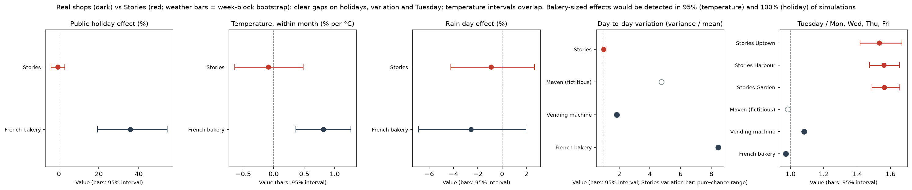

# Stories Coffee: Garden's recorded unit costs are about 43% higher on every product

**Team:** Rakan Bou Hatoum Hamadeh · Muche Abere Workie
EECE 490 (Introduction to Machine Learning), American University of Beirut · Hackathon, October 17, 2026

## Bottom line
**Measured.**
- Garden's recorded unit cost is about 1.43× Harbour's on every product (1.426–1.439 across the 45 products).
- No price changed from January to June.
- The 10% discount cost $1,706. We found no evidence it raises basket size beyond what random assignment would produce.
- Against the Monday, Wednesday, Thursday and Friday average, Tuesday brings 1.53× the transactions and Saturday 0.69×, at every branch.

**Estimates that depend on assumptions.**
- **Garden costs.** +$15,888 gross profit per six months, but only if the whole recorded gap is real, avoidable cash. If the gap is only in how costs are booked, there is no saving. The first step is to compare invoices and cost allocations for 5–10 products.
- **Price review.** +$8,096 per six months from an inflation-matched price review at all branches, at an assumed elasticity of −1. That means customers cut purchases 1% for every 1% price rise.

The biggest opportunity is to find out why Garden's costs are recorded 43% higher, and to fix it if the cost is real. The next is a price review, since prices did not change while Lebanese consumer prices rose about 17% a year. Each action below comes with the test that would confirm it before a chain-wide change.

**Actions, ranked by the estimate in each row's central case**

| Rank | Action | Evidence | Key facts | Estimate, 6 months | Confirming test |
|---|---|---|---|---|---|
| 1 | Audit how Garden's standard costs are set, and bring them to Harbour's level if the cost is real | Gap measured; value depends on assumptions | About 1.43× Harbour's recorded cost on every product (1.426–1.439), unchanged for six months; Garden keeps 47% of sales as gross profit, Harbour 65% | +$15,888 only if the whole recorded gap is real, avoidable cash; $0 if it is an accounting difference | Compare Garden's and Harbour's supplier invoices for 5–10 products; check how overheads are loaded into unit cost |
| 2 | Review prices at all branches with an inflation-matched rise of 6.86% | Depends on assumptions | 0 price changes on 135 price lists; Lebanon CPI +17.25% a year; Garden's prices are 95% and Uptown's 91% of Harbour's | +$8,096 at elasticity −1 (range −$3,907 to +$20,922); Garden and Uptown alone +$4,722 | Raise prices in randomly chosen branch-weeks (each branch alternates) for about eight weeks, so customers cannot switch between raised and unraised products; roll out if units fall by less than 10.5% |
| 3 | Find what drives Tuesday and test it on Saturday | Pattern measured; the driver is a hypothesis | Tuesday is 1.53× the Monday, Wednesday, Thursday and Friday average at every branch; it is not a discount day (10.1% vs 9.4% of transactions discounted); Saturday is 0.69× on the same base. The surge is more distinct existing customers, not more trips per customer, consistent with a chain-wide trigger such as an app notification or loyalty-member offer (hypothesis, not shown) | +$1,734 to +$7,993 (see the Saturday estimate) | Check Stories' app/loyalty campaign logs for Tuesdays and ask operations what happens then; then A/B test it on Saturdays by branch-week |
| 4 | Prompt food with drink orders, without a discount | Depends on assumptions | 59% of drink orders carry no food; the attach rate runs from 38.1% to 43.0% by drink | +$644 to +$4,341 | Switch the till prompt on and off by branch-week at random (switchback) for about eight weeks; we have not computed the detectable effect for this design |
| 5 | Pilot stopping the blanket 10% discount at one branch | Cost measured; effect on visits untested | Costs $1,706; no evidence it raises basket size beyond random assignment | Up to +$1,706 if no visits are lost | Stop it at one branch for four weeks before stopping it chain-wide |

How to read it:
- **Ranking.** The rows are conditional scenarios, not comparable expected returns: each holds only if its own assumption holds. They are ordered by the estimate in a central case we chose for each row: (1) the whole recorded gap is avoidable cash, $15,888; (2) elasticity −1, $8,096; (3) Saturday gains 50% of Tuesday's lift with no shifting, $6,937; (4) a 2.5-point rise in the attach rate at the average food margin, $2,171; (5) no visits lost, $1,706.
- **Overlap.** Rows 1 and 2 overlap at Garden. With the 6.86% rise at elasticity −1, Garden sells fewer units, so the cost fix saves less: doing both is worth $1,019 less than the sum (`results/opportunity_cost_price_overlap.csv`).
- **Per year.** Yearly figures are six months × 2 throughout.

**Also decided**
- **Harbour's 15% promo.** Do not extend it without a proper test. It gave $470 of discounts, and the rise in promoted categories grew after it ended (finding 6).
- **Tuesday staffing.** Use the weekday forecast. This needs only the Tuesday pattern to persist, not its cause to be known. Its June error on Tuesdays was 9.0 transactions a day, against 15.2 for the seasonal naive baseline (finding 5).
- **Win-back campaigns.** Do not target them with a churn model. In [`CUSTOMERS.md`](CUSTOMERS.md) the selected model scored a PR-AUC of 0.0995 on held-out customers, against 0.0877 for the baseline. The gain is small, not clearly significant, and not usable for targeting.

## The business problem
Stories already knows what each branch sells. We looked for decisions where money is left on the table: what each branch's products are recorded to cost, how each branch sets prices, whether its discounts earn back what they give away, and when customers come. Gross profit is the measure throughout, because revenue would hide Garden's problem.

## Measured findings
All figures are computed from the data after removing 132 exact duplicate rows. Each finding names its script and tables.

1. **Garden keeps far less of each sale as gross profit.** The gap is the same every month (Garden 46.7–47.2%).

   | Branch | Revenue (USD) | Gross profit (USD) | Gross margin |
   |---|---|---|---|
   | Harbour | 150,099 | 97,503 | 65.0% |
   | Uptown | 55,554 | 34,795 | 62.6% |
   | Garden | 99,531 | 46,696 | 46.9% |

2. **The gap is mostly in recorded unit cost; Garden's lower prices also contribute (see the price-only scenario under Estimated business value).** Garden's recorded unit cost is about 1.43× Harbour's on every one of the 45 products (range 1.426–1.439), while its prices are about 5% *lower*.
   - **Follow-up tests.** [`GARDEN_CAUSE.md`](GARDEN_CAUSE.md) finds a best-fit factor of 1.4302 (95% interval 1.4297 to 1.4309), with every product within cent rounding of it and no fixed fee per unit. The factor does not move with Brent crude, even though Brent roughly doubled.
   - **Sales side.** Garden's customers, hours and baskets look like the other branches'.
   - **Interpretation.** This is consistent with a branch-level standard-cost or allocation rule. The data cannot tell whether Garden's costs are higher in cash or only recorded higher.
   - **Source.** `src/margin_analysis.py`, `results/margin_by_branch.csv`, `results/unit_cost_ratio_by_product.csv`.

3. **Each branch has one fixed price list, set as a flat share of Harbour's prices.** All 135 product-branch pairs have exactly one price and one unit cost for all six months. Every Uptown price is 91.2–91.6% of Harbour's and every Garden price is 95.1–95.3%. At list prices the margin is Harbour 65.3%, Uptown 62.9% and Garden 47.2%. Source: `src/pricing_analysis.py`, `results/pricing_*.csv`.

4. **Tuesday brings 1.53× the transactions of the Monday, Wednesday, Thursday and Friday average at every branch, and weekends are the quietest (Saturday 0.69×).** Mean transactions per day, all branches:

   | Mon | Tue | Wed | Thu | Fri | Sat | Sun |
   |---|---|---|---|---|---|---|
   | 178.0 | 284.5 | 186.2 | 180.0 | 197.5 | 128.7 | 155.7 |

   - **Every branch, every week.** Tuesday over the Monday, Wednesday, Thursday and Friday average is 1.56 at Garden, 1.53 at Harbour and 1.52 at Uptown. It is the busiest day in all 25 full weeks, with weekly ratios of 1.32–1.69.
   - **Not a recording error we tested.** No other day is depleted, there are no copied records, it is not a few event days, and the hours and baskets are unchanged (permutation p = 0.75).
   - **Not a discount day.** 10.1% of Tuesday transactions carry a discount, against 9.4% on other days. The identified-customer share is 64.2% against 63.4%, and dine-in is 58.3% against 59.3%.
   - **What the extra Tuesday transactions are made of** ([TUESDAY_DECOMP.md](TUESDAY_DECOMP.md)). The excess is about 95.4 transactions a week over the three branches. 65.3% of it is more distinct customer IDs on the day [62.0%, 68.8%], 0.6% is more trips per ID [−0.1%, 1.2%], and 34.2% has no Customer ID [30.7%, 37.3%], so it cannot be attributed.
     The extra IDs are mostly ones that also buy on other days, not new ones: from week 9 on only 2.6% of the excess comes from IDs first seen that week, and 99.1% of Tuesday customers also buy on other days.
     This says what the surge is made of, not why it happens. The cause is not in the data; a campaign calendar or till records would be needed to test it.
     The surge is more distinct existing customers, not more trips per customer, so whatever drives it reaches a broad share of the customer base at once. That is consistent with a chain-wide trigger such as an app notification or loyalty-member offer (hypothesis, not shown). Confirming step: check Stories' app/loyalty campaign logs for Tuesdays.
   - **Driver.** Our hypothesis is an internal driver; it is not established.
   - **Weekends** average 0.767 of the Monday, Wednesday, Thursday and Friday level [0.745, 0.790]; Saturday alone is 0.69× (`results/tuesday_weekday_ratios.csv`).
   - **Commuters and students.** Weekday mornings are not over-represented: 9.78% of weekday transactions fall between 07:00 and 09:59, against 9.55% at weekends. Weekday sales show no clear dip while AUB students were away; every interval includes zero.

   **When customers come.** Dine-in is about 46% of transactions every hour until 17:00, then jumps to 69.9% at 18:00 at all three branches. The evening also brings the largest share of traffic (44.2% after 19:00) and of dessert baskets (16.6%). All branches share the same hourly and weekday shape (correlations 0.99 and above), so the data cannot tell what kind of location each branch is. The 18:00 step is so sharp and so uniform that it may be a till default rather than customer behaviour ([`FINDING_weekend.md`](FINDING_weekend.md)). Check it against receipts from 17:30–18:30 before changing seating or staffing. If it holds, daytime calls for takeaway speed and evenings for seating, staff and an upsell test.

   Source: `src/tuesday_check.py`, `src/tuesday_decompose.py`, `src/daypart_analysis.py`, `results/tuesday_*.csv`, `results/daypart_*.csv`, `figures/tuesday_check.png`, `figures/daypart_ordertype.png`.

5. **A weekday-and-trend forecast beats the baseline on June, most of all on Tuesdays.**
   - **Models.** We evaluated four on May, after training on January to April: a dummy (training mean), the seasonal naive baseline (same weekday last week), weekday + trend, and weekday + log trend.
   - **Test.** Only the model chosen on May, weekday + log trend, was refit on January to May and scored once on June, next to the dummy and the baseline. Weekday + trend was not chosen, so it was not scored on June, which keeps the test month untouched.
   - **The comparison favours the baseline.** The baseline uses last week's actual counts, while our model forecasts up to a month ahead with no June data.

   Mean absolute error, transactions per branch per day:

   | Model | May (validation) | June (test) | June, Tuesdays |
   |---|---|---|---|
   | Dummy | 15.45 | 20.27 | 55.04 |
   | Seasonal naive (same weekday last week) | 8.94 | 9.60 | 15.20 |
   | Weekday + trend | 6.54 | not scored | not scored |
   | Weekday + log trend | **6.12** | **6.95** | **9.02** |

   Source: `src/forecast.py`, `results/forecast_mae.csv`, `results/results.csv`, `figures/forecast_june.png`.

6. **Harbour's 15% promo on Cold Coffee and Desserts shows no clear evidence of causing extra sales.** We ran a difference-in-differences on daily units, with Garden and Uptown as controls and a bootstrap over weeks.
   - **During the promo** (March 12 to May 19), the promoted categories rose +13.7% [+2.0, +27.7].
   - **After it ended**, the rise grew to +18.6% [+8.1, +29.2].
   - **Control choice matters.** With Garden as the only control the effect is +6.9% [−4.3, +21.0]; with Uptown it is +21.1% [+6.0, +41.1].
   - **Placebos are near zero.** A pure price effect would be expected to fade when the discount ends, although habits formed during a promo can persist. Because the rise grew after the end and its size depends on the control branch, we do not credit the promo with it.
   - **Source.** `src/promo_analysis.py`, `results/promo_*.csv`, `figures/promo_weekly.png`.

7. **The 10% discount costs $1,706, and we found no evidence it raises basket size beyond what random assignment would produce.** It appears on 5.5–5.8% of lines at every branch, month and weekday. Discounted transactions look 0.23 items bigger, but shuffling the discount at random across lines produces the same gap, because bigger baskets simply have more lines for it to land on. For the same product at the same branch, a discounted line has the same quantity as a full-price one. Its effect on visits is untested. Source: `src/discount_analysis.py`, `results/discount_*.csv`.

8. **59% of drink orders carry no food; of the variables we measured, only drink category was linked to the food-with-drink rate.** The attach rate is 40.8% overall and is the same across branches, hours, weekdays and months. It runs from 38.1% for Cold Coffee to 43.0% for Matcha & Tea (p < 0.0001). Cold Drinks with Bakery sells at 0.63 of the expected rate. The full write-up is in [`FINDING_8.md`](FINDING_8.md). Source: `src/basket_analysis.py`, `results/basket_*.csv`.

## Did outside factors cause this?
We tested public data against the Tuesday surge and Garden's 1.43×, and compared our data with real shops.
- **Location assumption.** Stories is Lebanese and branch addresses are not in the data, so all branches are treated as being in Greater Beirut (lat 33.89, lon 35.50).
- **How to read it.** Real-shop values are references, not causes. Brackets are 95% intervals.
- **Multiple tests.** We ran about 14 tests without a multiple-testing correction, so treat any single borderline result with caution.
- **More.** Full detail is in [`docs/outside_factors.md`](docs/outside_factors.md), and sources are in [`data/README.md`](data/README.md).



| Factor | Data source | Real-world effect | Our effect | Verdict |
|---|---|---|---|---|
| Public holidays | holidaydb.com, calendarlabs.com; French government API | French bakery +36% [+19, +54] | −0.5% [−3.9, +3.0] | Not supported by our test |
| Temperature, within month | Open-Meteo (Beirut; Paris for the bakery) | Bakery +0.82% per °C [+0.37, +1.27] | −0.09% per °C [−0.54, +0.37] | Not supported by our test; difference borderline (intervals touch) |
| Hot days and cold drinks | Open-Meteo; United Baristas | One London café +2.2 points per °C | +0.08 points per °C [−0.06, +0.22] | Not supported by our test |
| Rain | Open-Meteo; Foursquare and AccuWeather | Bakery −2.6% [−6.9, +2.0]; US shops lose traffic in rain | −0.9% [−3.6, +1.9] | Not supported by our test; cannot tell if different |
| Ramadan | L'Orient Today | — | Evening share +0.4 points [−1.4, +2.2] | Not supported by our test |
| Security escalation from Mar 2 | Al-Monitor, LBC | — | March +2.4% [−2.6, +6.8] vs trend | Not supported by our test |
| School or campus (Tuesday) | AUB calendar, LBC | — | Tuesday ratio −0.026 [−0.096, +0.050] with AUB out | Not supported by our test |
| A local cause near one branch | Transactions | — | Tuesday ratio 1.53–1.56 at every branch | Not supported by our test |
| Tuesday peak itself | Kaggle shops; Placer.ai; Square UK | Bakery 0.97, vending machine 1.08; chains peak on Saturday | 1.53 | Ours is unusual |
| Day-to-day variation | Kaggle shops | Bakery 8.45, vending machine 1.84, Maven (fictitious) 4.76 | 0.98 (pure-chance range 0.88–1.14) | Ours is much steadier |
| Growth vs inflation | Lebanon CPI (CAS) | +17.25% a year | +52.6% transactions; no price changed | Growth is volume, not price |
| Fuel and Garden's costs | FRED Brent crude | Brent weekly mean $62.93 to $124.61 | Garden's cost ratio moved 0.0001 | Not supported by our test |
| World coffee price and costs | IMF arabica via FRED | −15.4%, Jan to Jun | All 135 unit costs unchanged | Consistent with standard recipe costs |
| Industry cost levels | Starbucks 10-K; Zest café targets | Starbucks 31.4% cost of goods | Harbour 35.0%, Uptown 37.4%, Garden 53.1% | Garden is the abnormal branch |

- **Weather and seasons.** Temperature, rain and the hot-day cold-drink shift show no effect in our data. A real bakery shows a temperature effect our data would have detected, though only just.
- **Calendar and conflict.** Holidays, Ramadan and the March escalation leave no mark we could detect. The bakery's holiday effect is far outside our interval.
- **Tuesday.** It is the same size at all three branches, so it is not unique to one branch. It did not fade while AUB was online or out, and Thursday is not raised, which weakens a Tuesday/Thursday class timetable. Among the reference shops only the vending machine's busiest weekday is Tuesday, at 1.08×; none shows a Tuesday peak near Stories' 1.53×, and we found no published source with one. Our hypothesis is an internal driver; it is not established.
- **Steady demand.** Our daily counts vary no more than chance allows, while every reference shop varies more. Our hypothesis is stable, habitual demand from regulars, which fits these figures but is not shown by them: 98.5% of identified customers bought more than once in six months, 93.1% returned within 30 days of their first visit, and 93.8% used more than one branch.
- **Garden's costs.** The 1.43× ignores world coffee and fuel prices and is about the same on every product (1.426–1.439). That is consistent with how Garden's standard costs are set. Location costs such as rent and delivery distance could not be tested without branch addresses.
- **Prices.** They did not change while consumer prices rose about 17% a year, so the 52.6% growth is in transaction counts, not price.
- **Not a public template.** Our data shares only its framing with the public Maven dataset and shows no sign of being derived from it.

What the tests weaken and what they leave open:

| Observed result | Explanations weakened | Explanations still possible | Next test |
|---|---|---|---|
| Tuesday is 1.53× at all three branches, in all 25 full weeks | A cause next to one branch; weather; holidays; the school and AUB calendar; a Tuesday/Thursday class timetable | A chain-wide internal driver (app notification, loyalty offer, standing promotion); a data or posting artefact | Stories' app/loyalty campaign logs for Tuesdays; daily till (Z-report) or bank totals by weekday |
| Garden's unit cost is about 1.43× Harbour's on every product, unchanged for six months | Fuel or transport pass-through; a fixed delivery fee per unit; a different customer base | A branch-level standard-cost or overhead allocation; a real flat supplier surcharge; rent or location costs | Supplier invoices for 5–10 products; how overheads are loaded into unit cost |
| Daily counts vary no more than chance (0.98) | Weather, holiday and conflict effects of the size seen in the reference shops | Habitual demand from regulars; smoothing from how the data was recorded | Daily till totals for a few weeks |
| +52.6% transactions with no price change | Price rises; weather (it predicts −0.7% of the growth) | More customers or visits; seasonality we cannot see in six months | A second year of data |

## Estimated business value
These are estimates, kept separate from the measured facts. Six-month figures; per year = six months × 2.
- **Garden cost and price.** The two are computed together, not added (`results/garden_cost_price_combined.csv`).

  | Elasticity (assumed) | Cost fix only | Price fix only (+5.0%) | Both together |
  |---|---|---|---|
  | 0 | $15,888 | $4,975 | $20,863 |
  | −1.0 | $15,888 | $2,516 | $17,647 |
  | −2.0 | $15,888 | $174 | $14,585 |

  Uptown moving to Harbour's prices (+9.4%) is worth +$1,782 at elasticity −1, and breaks even at −1.56 (`results/pricing_scenarios.csv`). Both branch moves are part of the price review, so do not add them to it.
- **Price review at all branches.** Lebanon's consumer prices rose 17.25% in the year to June 2026. Assuming an even monthly path, that is 1.335% a month, which puts Stories' real prices **6.42% lower by June** (modelled). This assumes dollar menu prices track the lira-based CPI. We test one rise of 6.86% on the same six months of volume, with costs and discounts unchanged (`results/opportunity_inflation_price.csv`):

  | Elasticity (assumed) | Units | All branches | Garden + Uptown |
  |---|---|---|---|
  | 0 | 0% | +$20,922 | +$10,632 |
  | −1.0 | −6.4% | +$8,096 | +$4,722 |
  | −2.0 | −12.4% | −$3,907 | −$810 |

  It breaks even at elasticity −1.67, a 10.5% fall in units.
- **Saturday, if the Tuesday driver can be copied.** Each branch's actual Saturday basket and margin are used. Because most customers are regulars who also use several branches, some extra Saturday visits may be shifted from other days or branches. We therefore also show an illustrative case where half are shifted (`results/opportunity_saturday_range.csv`):

  | Scenario | No shifting | Half shifted |
  |---|---|---|
  | Saturday gains 25% of Tuesday's lift | +$3,468 | **+$1,734** (illustrative downside: 50% displacement assumed; it could be higher) |
  | Saturday gains 50% of Tuesday's lift | +$6,937 | +$3,468 |
  | Saturday reaches the Mon/Wed/Thu/Fri average | **+$7,993** | +$3,996 |
- **Food with drinks.** A 1 to 5 point rise in the attach rate is worth +$644 to +$4,341 (`results/basket_value_scenarios.csv`). A 10% pairing discount would need a 9.4-point rise just to break even. An evening dessert upsell of 1 to 5 points, worth +$455 to +$2,273 (`results/daypart_evening_dessert_total.csv`), is part of this row.
- **10% discount.** Stopping it saves up to $1,706, or $3,412 a year, if no visits are lost.
- **Harbour promo.** If the promo caused all of the rise, its net was +$599, with a range of −$299 to +$1,451 (`results/promo_value.csv`).

## Assumptions and what would change the recommendation
| Assumption | If it is wrong |
|---|---|
| The `Unit Cost` column records money Stories really pays per item | If Garden's cost includes overheads booked differently, the $15,888 is a bookkeeping difference and no cash is saved |
| Garden could buy at Harbour's unit costs | If part of the gap is unavoidable, such as rent or delivery distance, the gain scales down |
| Price elasticity is between 0 and −2, the same for every product | Beyond about −1.67, the all-branch price review loses gross profit |
| Lebanon's lira-based CPI is a fair guide to pressure on dollar menu prices | The 6.42% real-price loss is then overstated or understated |
| Tuesday's extra transactions are extra visits | Items per transaction are unchanged on Tuesdays, so there is no sign of split orders in basket size; till-session counts would confirm it |
| Extra Saturday visits are new, with no extra labour cost | The half-shifted column is an illustrative downside; displacement could be higher than half |
| All branches are in Greater Beirut | Local weather or events could differ by branch; we cannot test a cause that affects only one branch |
| The 132 exact duplicates are recording errors | If they are real, revenue rises by $741 (0.24%); nothing else changes |
| Anonymization changed only branch names and IDs | If it altered other fields, some patterns could partly reflect that process; Stories can check against its own records |

## A practical test Stories could run
The confirming test for each action is in the action table. Two more:
- **Garden prices.** Move Garden to Harbour's prices in randomly chosen weeks (for example 4 of 8), with Harbour and Uptown as a check on chain-wide trends. Randomizing by week rather than by product avoids customers switching between raised and unraised products.
- **Evening upsell.** From 18:00, suggest a dessert or a drink-and-dessert bundle. Switch it on and off by branch-week at random (switchback) for 6–8 weeks, so no single branch carries the whole treatment.

## Weak areas and uncertainty
- Only six months of data, with no yearly seasonality. Sales grew through the period, so yearly figures (six months × 2) may be too low if growth continues.
- Prices never change in the data, so price sensitivity is assumed, not measured.
- The Tuesday driver is unknown. Tuesday staffing needs only the pattern to persist; the Saturday transfer depends on finding the cause.
- The promo test has only two control branches, and its result depends on the choice of control.
- The forecast was tested on one month.
- 36.5% of lines have no Customer ID, so customer figures describe identified customers only.

## Approaches we considered and rejected
- **Estimating price sensitivity from differences between branches.** Location and size drive those differences, not price.
- **Estimating price sensitivity from the 10% discount.** It is applied at the till to about 6% of lines in every branch, month and hour, so it gives no menu-price variation to estimate from.
- **Adding the Garden cost and price gains.** They interact, so we computed them together.
- **Plain basket "lift", or a model of whether a basket takes food.** Basket size distorts lift, and of the variables measured only drink type was linked to taking food.
- **More complex forecast models.** There are only 151 training days per branch, and a simple regression already beats the baseline.

## Data and reproduction
Data, column schema, quality checks, external sources and licenses are in [`data/README.md`](data/README.md). Working notes are in [`docs/internal/`](docs/internal/).

```bash
pip install -r requirements.txt
# place stories_transactions.csv in data/ (see data/README.md)
cd src
python margin_analysis.py        # Garden margin and unit costs
python pricing_analysis.py       # price lists and Garden/Uptown price scenarios
python tuesday_check.py          # Tuesday checks, discount and customer mix, regular customers
python tuesday_decompose.py      # what the Tuesday excess is made of (TUESDAY_DECOMP.md)
python weekend_check.py          # Tuesday vs weekend offset, takeaway step at 18:00 (FINDING_weekend.md)
python forecast.py               # June forecast vs seasonal naive; replaces its own rows in results/results.csv
python promo_analysis.py         # Harbour 15% promo, 30 seconds to about 2 minutes
python discount_analysis.py      # 10% discount
python basket_analysis.py        # food with drinks
python external_factors.py       # weather, calendar, conflict, school/campus, cost checks
python benchmarks.py             # published coffee-chain benchmarks (after external_factors.py)
python garden_cost_cause.py      # Garden cost-cause tests (GARDEN_CAUSE.md)
python reference_compare.py      # public shop datasets: needs the Kaggle API, see below
python outside_summary.py        # outside-factors figure (after the two scripts above)
python opportunity_estimates.py  # Saturday, price-review and cost/price overlap estimates
python daypart_analysis.py       # weekday vs weekend, commuter and student tests, dayparts
python customer_model.py         # churn model and segments (CUSTOMERS.md); appends rows to results/results.csv
```

The reference comparison needs the Kaggle API with a `kaggle.json` token, and the download commands are in `data/README.md`. Without those downloads the script cannot run. Its outputs are `results/reference_signatures.csv`, `results/reference_template_maven.csv`, `results/reference_effect_transfer.csv` and `figures/reference_signatures.png`. They feed the real-shop columns of the outside-factors table and `figures/outside_factors_summary.png`. Every other script needs only the transaction file and the committed files in `data/external/`.
